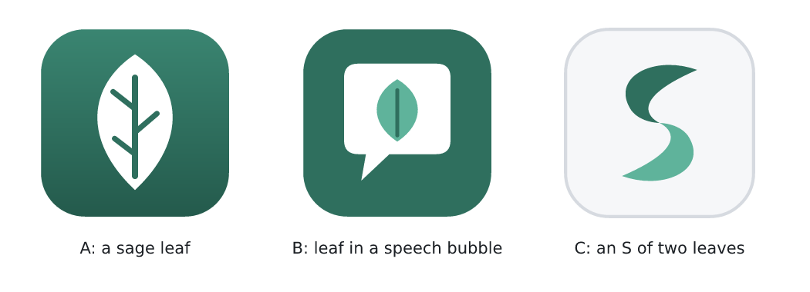

# Plan: sage-icon

## What the owner asked for

"Start the Sage icon job": the roadmap item "A Sage icon for the installer, the shortcuts and the window
(the installer uses Electron's default icon for now)."

## What we found

- Sage has no icon of its own. The installer, `Sage.exe`, the Start-menu and desktop shortcuts, the
  taskbar and the window all show Electron's default icon.
- The installer tool (electron-builder) takes one square picture of at least 256 by 256 pixels and makes
  every Windows icon size from it, including the installer's own icon.
- On Windows the window and taskbar use the icon inside `Sage.exe`. When Sage runs from source, and on
  Linux, the window needs to be given the picture itself.
- Sage's colours are a sage green (`#2f6f5e`, and a lighter `#5fb39b` in dark mode), which suits the name.

## The design

Three original designs, drawn for Sage in its own colours (no outside artwork):

- **A: a sage leaf** (recommended): a white leaf with its veins on a green tile. Simple, and it stays
  clear at the smallest sizes.
- **B: a leaf in a speech bubble**: says "assistant you talk to", a little busier when small.
- **C: an S made of two leaves**: lighter, but the light background is harder to see on a light
  taskbar.

The team builds **A** unless the owner comments B or C on this pull request before approving.

## What we'll change

1. **The icon files.** The design is kept as a drawing file (`build/icon.svg`, plain text that anyone
   can edit) and as a 512 by 512 picture made from it (`build/icon.png`) for the installer tool. A short
   note says how to make the picture again after changing the drawing. No new package is added to Sage
   for this.

   *Check:* a test checks that `build/icon.png` exists, is a real 512 by 512 picture, and is the icon
   the installer settings name.
2. **The installer and the app.** `electron-builder.json` names the icon, so the installer, `Sage.exe`,
   the shortcuts and the taskbar show it.

   *Check:* an unpacked Windows build on the review machine works and its `Sage.exe` carries the new
   icon; the owner sees it in the installer and on Windows (step 5).
3. **The window when run from source.** The window is given the same picture, copied into Sage's built
   files, so it shows in the taskbar when Sage runs from source on Windows and on Linux. Nothing about the
   window's security settings changes.

   *Check:* the window settings test, updated for the icon; the build copies the picture.
4. **Docs.** The README shows the icon at the top; the roadmap item, `docs/architecture.md` (where the
   icon lives), the repo's guidelines, `CHANGELOG.md`, and the Windows checklist ("the installer,
   shortcuts, taskbar and window show the leaf icon").

   *Check:* `npm run verify`, and a plain-English read before final approval.
5. **The owner's check on Windows** before final approval: build and install, and look at the installer,
   the shortcuts, the taskbar and the window.

## Who's on it

The CEO did the research and drew the designs. Engineer, Security Officer, Auditor, and a Plain-English
Reader before final approval. QA, a plan check and a second security review are skipped: a small job
that adds no package and touches no security setting.

## Risks

- **The picture is made by hand from the drawing**, with a tool outside the repo, so a later change to
  the drawing needs the same step again. The note says how.
- **Windows caches icons.** A shortcut may keep the old icon until Windows refreshes it; uninstalling
  the test copy first, or signing out and in, fixes it.

## Out of scope

- A macOS icon (macOS comes later), a tray icon, and different icons for light and dark themes.
- An icon inside the chat window's page.
